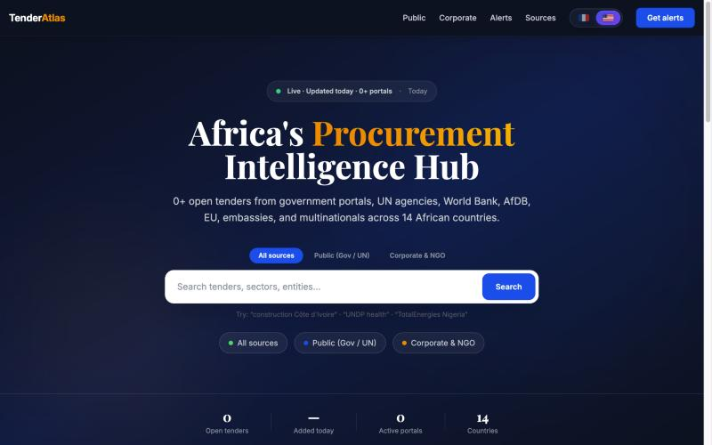

# TenderAtlas

Open-source search engine for procurement tenders across Africa.

TenderAtlas scrapes tenders every day from government procurement portals, UN agencies,
development banks, NGOs, embassies and multinationals, then makes them searchable by
country, sector and deadline, in English and French, with optional weekly email alerts.



## Sources

36 scrapers in [`scrapers/`](scrapers), including:

- **Government portals:** Benin, Côte d'Ivoire, Senegal, Cameroon, Togo, Burkina Faso, Mali, Guinea, Niger, Nigeria, Ghana, Kenya, Rwanda, Uganda, Tanzania, South Africa, Morocco, Tunisia, Madagascar, Mozambique, DR Congo
- **Multilateral:** World Bank, African Development Bank, UNDP, UNGM, WHO, IFAD, EIB, IsDB, USAID, EU
- **Other:** NGOs, embassies and multinational corporate tenders

## Features

- Full-text search with autocomplete, filters by country, sector and source type
- One SEO-friendly page per tender, country and sector, plus sitemap and structured data
- Weekly email digests with double opt-in (via [Resend](https://resend.com))
- English / French interface

## Stack

Next.js 14 (App Router) · TypeScript · Tailwind CSS · Drizzle ORM · MySQL · Cheerio

## Getting started

```bash
cp .env.example .env.local   # set DATABASE_URL at minimum
npm install
npm run migrate              # create tables
npm run scrape               # run all scrapers (or: npm run scrape:country -- bj)
npm run dev                  # http://localhost:3000
```

Run `npm run daily` on a schedule (cron, Railway, GitHub Actions…) to keep data fresh,
and `npx tsx scripts/send-digest.ts` weekly to send alerts.

## Adding a source

Each scraper exports a `scrape()` function that returns normalised tenders
(see [`scrapers/base.ts`](scrapers/base.ts)). Copy an existing one, register it in
[`scrapers/cron-runner.ts`](scrapers/cron-runner.ts), and open a pull request.

Please scrape responsibly: respect each site's terms and `robots.txt`, keep request rates low,
and keep the identifying `User-Agent`.

## Disclaimer

Tender data comes from public sources and is provided for information only. Always check
the official source before responding to a tender. TenderAtlas is not affiliated with any
government or agency.

## License

[MIT](LICENSE)
